# Vero: architecture and sequence diagrams (Phase 1, Vero Cash)

All diagrams match [`contracts/DATA_CONTRACTS.md`](contracts/DATA_CONTRACTS.md). Numbers come from the demo scenario in [`DESIGN.md` §8](DESIGN.md#8-reference-demo-scenario-all-teams-test-against-these-numbers) (Pizzeria Amalfi, "today" = 5 May 2025).

**Design choice (Option B):** the **backend owns all data and domain logic** (statement import, revenue model, forecast, planner, credit sizing, policy, execution, receipts) and **hosts the agent's tools**. The **AI service is a thin agent runtime**: prompts, the tool-calling loop, the LLM and explanation texts. The agent reaches data only through read-only tools and can never execute anything. If the AI service fails, the backend finishes the run on its own (FALLBACK).

---

## 1. Architecture

### 1.1 System context

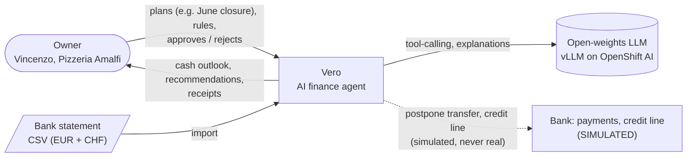

### 1.2 Containers

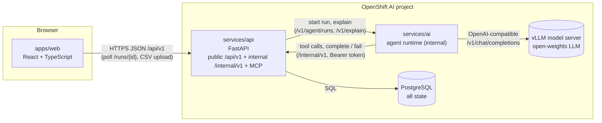

| Container | Owns | Never does |
|---|---|---|
| **web** | Screens, CSV upload, user input, polling, display formatting | Calculate money, decide, call anything but `/api/v1` |
| **api** | Database, statement import, revenue model, engine (forecast, planner, credit sizing), tools, mandate and policy → lanes, simulated execution, receipts, run orchestration, fallback | Let the model authorize anything; expose `/internal` to the browser |
| **ai** | Prompts, agent loop, LLM calls, explanation texts + grounding check | Touch the database, compute money, decide lanes, execute |
| **db** | Source of truth | Be reachable from outside the cluster |
| **llm** | Text generation, tool-call selection | Be reachable from outside the cluster |

### 1.3 Components

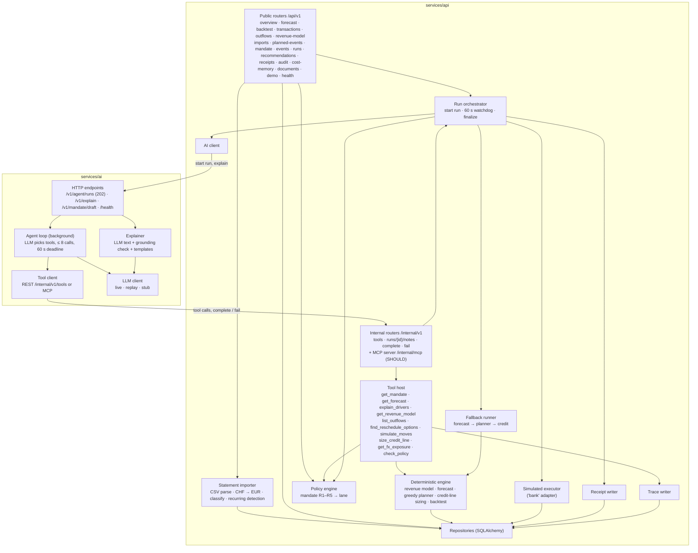

### 1.4 Deployment on OpenShift AI (hard criteria: app and model both run there)

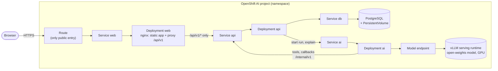

- Only the web Route is public. nginx proxies **only `/api/v1/*`**, so `/internal/*` and `/internal/mcp` are never reachable from the browser.
- Configuration (Secret/ConfigMap):
  - api: `DATABASE_URL`, `AI_URL`, `INTERNAL_TOKEN`, `DEMO_MODE`, `DEMO_AS_OF_DATE=2025-05-05`, `STATEMENT_SOURCE=csv|db`
  - ai: `API_INTERNAL_URL`, `INTERNAL_TOKEN`, `LLM_BASE_URL`, `LLM_MODEL`, `LLM_API_KEY`, `LLM_MODE`

### 1.5 Who owns which data

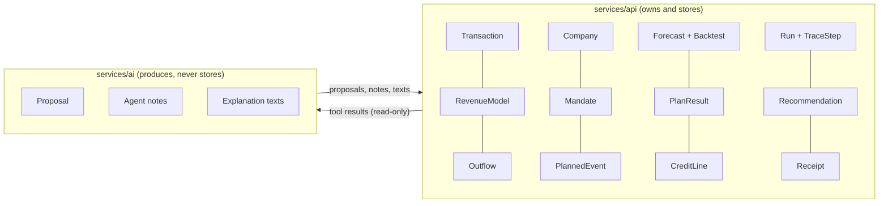

### 1.6 State machines

**Run**
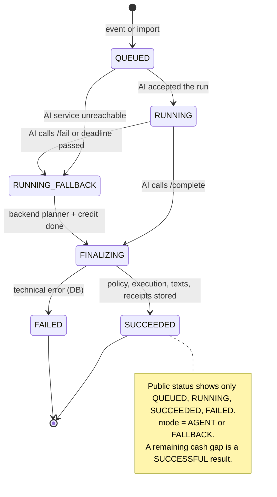

**Recommendation**
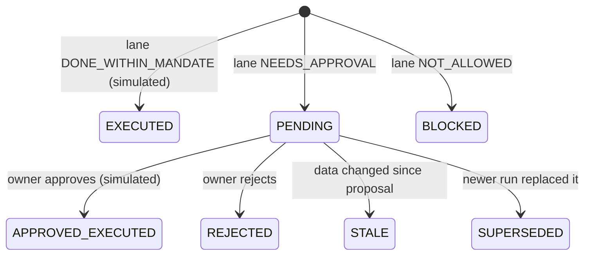

---

## 2. Sequence diagrams

### 2.1 Import the bank statement (seed / reset uses the same path)

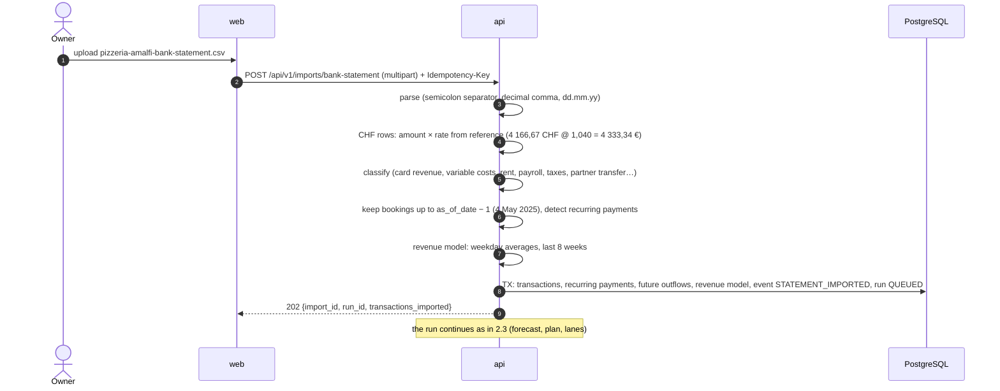

### 2.2 Open the dashboard

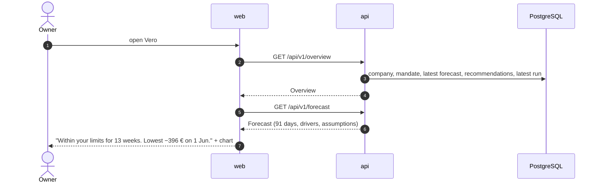

### 2.3 Owner plans the June closure → agent run → recommendations (main flow)

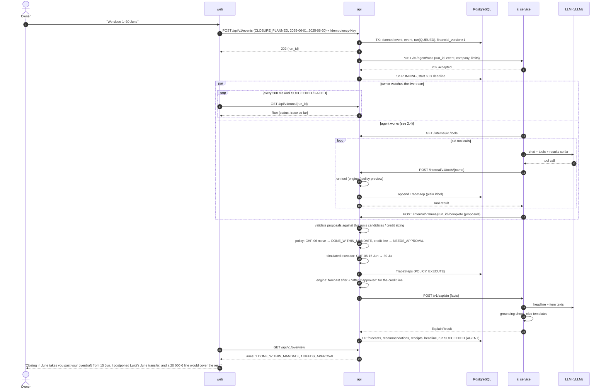

### 2.4 Inside the agent loop (tools through the backend)

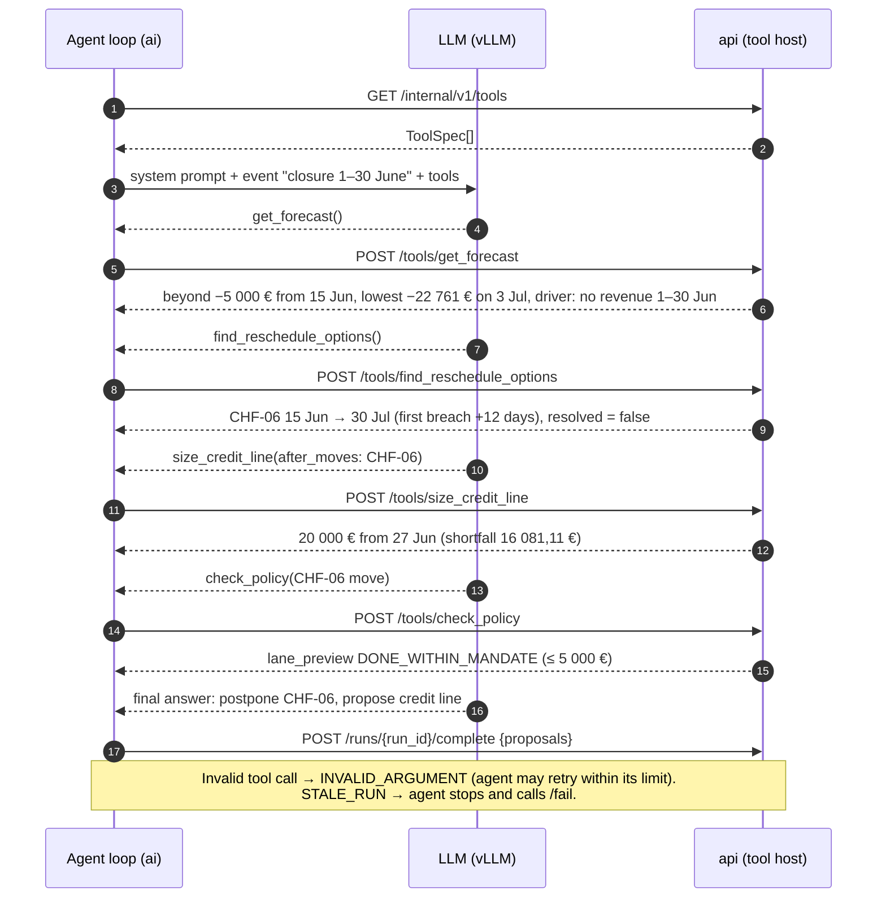

### 2.5 Fallback: model or AI service unavailable

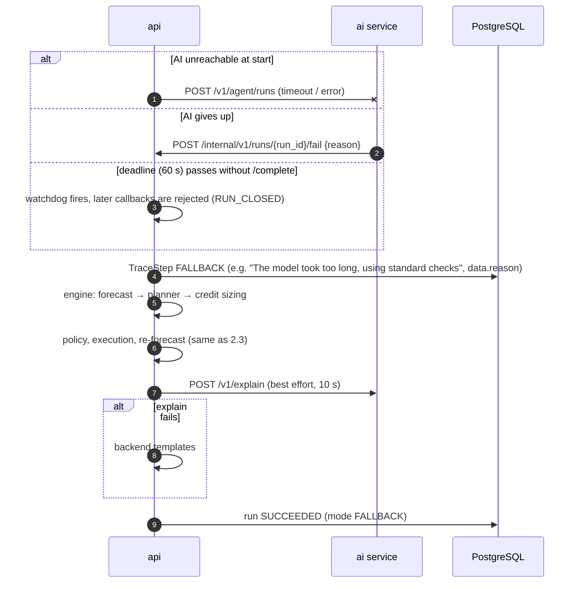

### 2.6 Owner approves the credit line

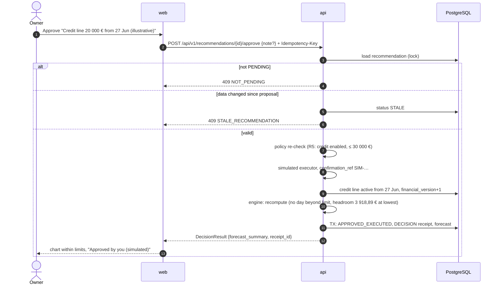

### 2.7 Owner rejects, or asks for something not allowed

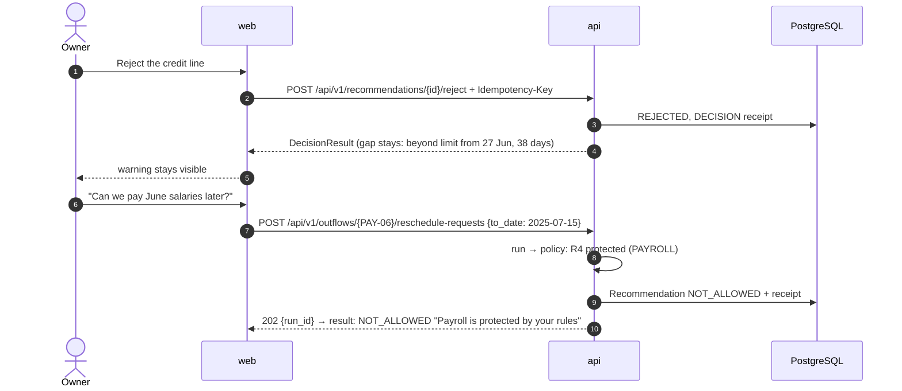

### 2.8 Owner changes the mandate

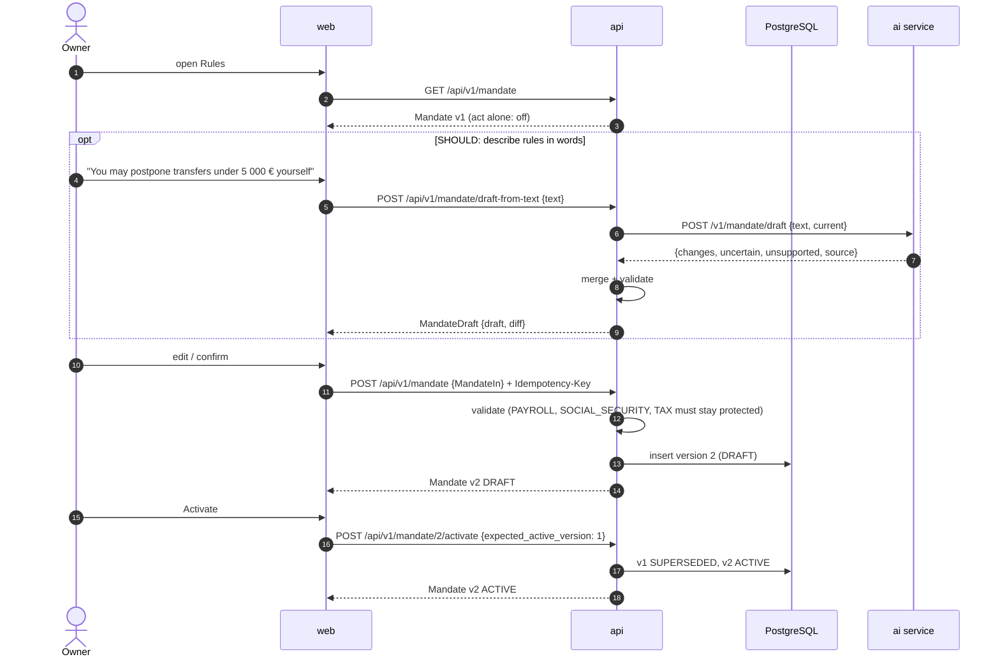

### 2.9 Demo reset

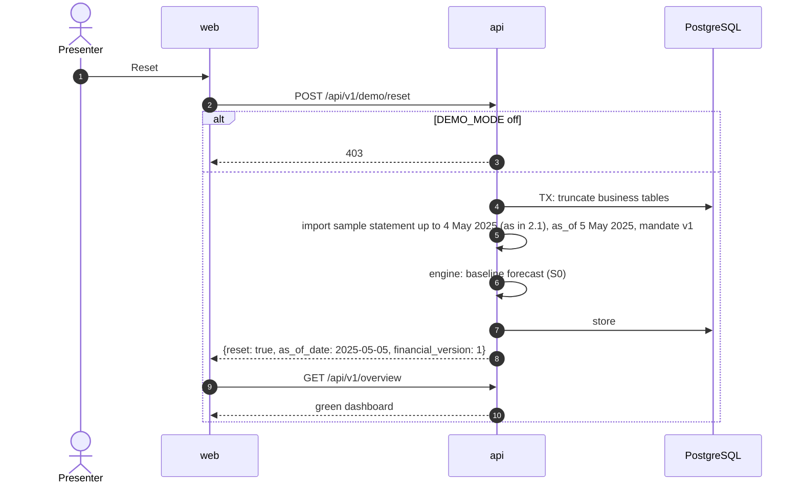

### 2.10 Backtest overlay (demo)

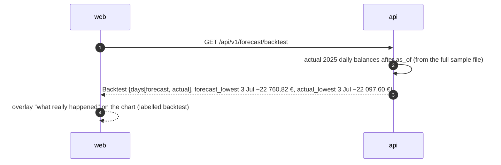

### 2.11 Health and model check (hard criterion #2)

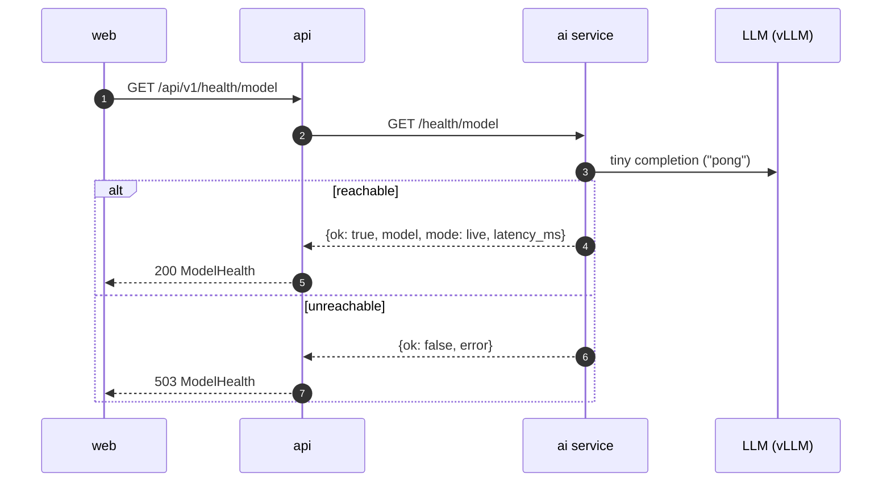
