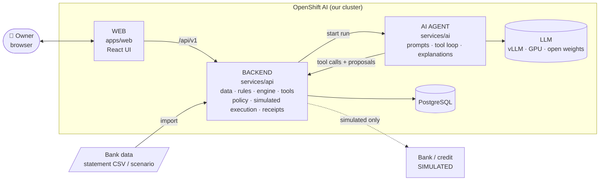

# Vero: high-level architecture (whiteboard version)

A one-page picture to draw for the team. For details see [`ARCHITECTURE.md`](ARCHITECTURE.md) and [`contracts/DATA_CONTRACTS.md`](contracts/DATA_CONTRACTS.md).

---

## 1. The drawing

Draw it left to right: **five boxes, one cloud, two arrows that matter.**

```
                         ┌──────────────────────────── OpenShift AI (our cluster) ─────────────────────────────┐
                         │                                                                                      │
 ┌──────────┐   HTTPS    │  ┌──────────────┐  /api/v1   ┌──────────────────────────┐  start run   ┌───────────┐  │
 │  OWNER   │───────────▶│  │     WEB      │──────────▶ │         BACKEND          │────────────▶ │    AI     │  │
 │ (browser)│◀───────────│  │  apps/web    │◀────────── │       services/api       │◀──────────── │  AGENT    │  │
 └──────────┘            │  │  React UI    │   JSON     │                          │  tool calls  │services/ai│  │
                         │  └──────────────┘            │  • data & rules (mandate)│  + proposals └─────┬─────┘  │
                         │                              │  • engine: forecast,     │                    │        │
 ┌──────────┐            │                              │    planner, credit sizing│                    │ prompts│
 │ BANK DATA│  import    │                              │  • tools for the agent   │                    ▼        │
 │ statement│───────────▶│─────────────────────────────▶│  • policy → lanes        │             ┌───────────┐   │
 │ (CSV) /  │            │                              │  • simulated execution   │             │    LLM    │   │
 │ scenario │            │                              │  • receipts              │             │ vLLM, GPU │   │
 └──────────┘            │                              └────────────┬─────────────┘             │open weights│  │
                         │                                           │ SQL                       └───────────┘   │
                         │                                    ┌──────▼──────┐                                    │
                         │                                    │ PostgreSQL  │                                    │
                         │                                    └─────────────┘                                    │
                         └──────────────────────────────────────────────────────────────────────────────────────┘
                                                   ┊ simulated only ┊
                                                   ▼                ▼
                                          payment changes     credit facility
                                          (no real money)     (illustrative)
```

The same picture as a rendered diagram:



---

## 2. How to explain it (≈ 2 minutes)

Point at each box in order.

**1. Owner and Web.** "The owner uses a simple web app. It shows the cash outlook, what Vero did, and what needs a decision. The web app never calculates money. It only shows what the backend sends."

**2. Bank data.** "Vero starts from the company's bank statement. For the demo that's the organizers' Pizzeria Amalfi 2025 statement: 1 125 transactions in EUR and CHF. The backend imports it, classifies every line, spots the recurring payments (rent, payroll, taxes, the CHF transfer to the owner's brother), and learns the usual weekly takings."

**3. Backend: the brain that can be trusted.** "The backend owns everything that must be exact and safe:
- the **data** and the owner's **rules** (the mandate: 'act alone up to 20k, never touch salaries or taxes');
- the **engine**: plain code that forecasts cash day by day, finds the gap and sizes a credit line;
- the **policy**: every proposed action is sorted into *done within your rules*, *needs your approval* or *not allowed*;
- **execution**, which is **simulated**: no real money moves;
- a **receipt** for every decision."

**4. AI agent: the brain that reasons and talks.** "The agent runs on an open-weights LLM on OpenShift AI. When something changes, for example Vincenzo says 'we close for all of June', the backend wakes it up. The agent **investigates by calling the backend's tools**: 'show me the forecast', 'find payments that could wait', 'size a credit line'. Then it **proposes** actions and writes the explanation in plain language."

**5. The key arrow: tools and proposals.** "The agent can **look**, but it can't **touch**. Its tools are read-only. It sends proposals, and the backend checks every proposal against the owner's rules before anything happens. If the model is down, the backend finishes the job on its own, so the demo always works."

**6. Everything inside OpenShift AI.** "The app, the agent and the model all run in our OpenShift AI cluster. That covers both hard requirements, and no financial data leaves the cluster."

---

## 3. One run, in five steps (draw as numbered arrows)

```
① Something changes      →  Vincenzo: "we close 1–30 June" (or a new statement is imported)
② Backend wakes the agent →  "here's what happened"
③ Agent investigates      →  calls tools: forecast → past the overdraft from 15 Jun, low −22 536 € on 3 Jul
                             → payments that can wait → size a credit line
④ Agent proposes          →  "postpone Luigi's June transfer" + "credit line 20 000 €"
⑤ Backend decides & acts  →  transfer postponed: done within your rules (simulated)
                             credit line: needs your approval → owner approves / rejects
                             (and a backtest shows the real 2025 low was −22 098 € on 3 Jul)
```

---

## 4. Who builds which box

| Box | Team |
|---|---|
| WEB | Frontend |
| BACKEND + PostgreSQL | Backend |
| AI AGENT | AI |
| LLM on vLLM, the cluster, deployment | DevOps |

---

## 5. Three sentences to remember

1. **The backend calculates and decides. The AI investigates and explains.**
2. **The agent can look but not touch.** Read-only tools, proposals only, owner's rules always applied.
3. **Everything runs on OpenShift AI, and every action is simulated and explained.**
