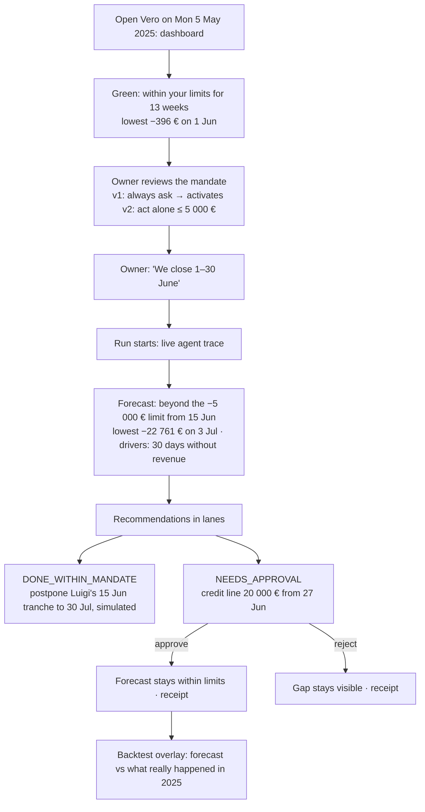

# Vero Cash: Phase 1 design

> **Status:** draft for team review.
> **Scope:** Phase 1 = **Vero Cash**, the challenge card's *Liquidity agent*: monitor the account, forecast cash ahead, act within the owner's rules, **propose a credit facility**, owner approves, execution simulated.
> **Demo data:** the organizers' sample **Pizzeria Amalfi** (Frankfurt) 2025 bank statement (EUR).
> **Out of scope (Phase 2, Vero Proof):** verifying that recurring costs are justified, see [`PROOF.md`](PROOF.md).
>
> **Related documents (single source of truth for their topic):**
> - [`contracts/DATA_CONTRACTS.md`](contracts/DATA_CONTRACTS.md): every endpoint, payload and field
> - [`ARCHITECTURE.md`](ARCHITECTURE.md): architecture and sequence diagrams
> - [`ARCHITECTURE_OVERVIEW.md`](ARCHITECTURE_OVERVIEW.md): one-page whiteboard version
>
> This document covers the *what* and *why*: requirements mapping, roles, the data, the forecast method, the run pipeline, business rules and the demo scenario.

---

## 1. What the challenge card asks us to show, mapped to Vero

| Card requirement | How Vero shows it |
|---|---|
| Monitor accounts | Imports the bank statement, classifies every transaction, detects recurring payments |
| Forecast cash flow *x* days ahead | Daily forecast, 91 days (13 weeks), **backtested** against what really happened in 2025 |
| Identify potential issues | First day beyond the owner's limit, how deep, how long, and **why** (drivers) |
| Automatically propose credit facilities | Sizes a **credit line** for the gap that remaining levers can't close |
| Explainable next steps | Every recommendation has checks, before/after numbers and a receipt, plus a plain-language explanation |
| **What agents analyse independently** | Lane **ANALYSED**: forecast, drivers, recurring payments, CHF exposure |
| **What they recommend** | Each proposed action is a **Recommendation** with evidence |
| **What requires user approval** | Lane **NEEDS_APPROVAL**: outside the mandate, and **always** for credit |
| **Whether execution is simulated or permitted** | Every action has `execution: "SIMULATED"`. Lane **DONE_WITHIN_MANDATE** = permitted by the mandate and executed in simulation. Lane **NOT_ALLOWED** = refused by the rules |
| Owner understands and responds | Headline and per-item texts from the model, grounded in computed facts; approve and reject; receipts |
| Open-weights LLM on OpenShift AI | The agent's tool-calling loop and the explanations run on our vLLM model |

**Show the lane names literally in the UI.** They are the card's vocabulary.

---

## 2. Roles: who does what

Design choice **Option B**: the backend owns all data and domain logic and hosts the agent's tools. The AI service is a thin agent runtime.

| Actor | Does | Never does |
|---|---|---|
| **Owner** (browser) | Sets the mandate, tells Vero about planned events (e.g. the June closure), reads the summary, approves or rejects | – |
| **Frontend** (`apps/web`) | Shows forecast (+ backtest), lanes, live trace, recommendations and receipts; sends commands; polls run status | Calculate money or decide anything |
| **Backend** (`services/api`) | Imports and classifies the statement; detects recurring payments; runs the **deterministic engine** (revenue model, forecast, planner, credit sizing); **hosts the agent's read-only tools**; applies the **policy**; **simulated execution**; receipts; run orchestration and **fallback** | Let the model authorize anything |
| **Agent** (`services/ai`, LLM on OpenShift AI) | Decides which tools to call, proposes actions, writes the headline and explanations | Touch the database, calculate amounts or dates, decide lanes, execute |

---

## 3. Core concepts

- **Transaction**: one imported bank statement line (EUR or CHF), classified into a category.
- **Recurring outflow**: a payment Vero detected as repeating (rent, payroll, social security, wage tax, utilities, the CHF partner tranche) or that the owner entered (quarterly tax prepayments). Future occurrences are **Outflows** in the forecast.
- **Revenue model**: expected daily card revenue and daily variable costs (produce, wine, wholesale), learned from recent history.
- **Planned event**: something the owner tells Vero about the future, e.g. **closure 1–30 June** (no revenue, no variable costs).
- **Mandate**: the owner's versioned operating rules (§5). Default v1 is conservative: everything needs approval.
- **Event**: something that changes the cash picture and starts a run: `STATEMENT_IMPORTED`, `CLOSURE_PLANNED`, `OUTFLOW_ADDED`, `INFLOW_ADDED`.
- **Run**: one pass after an event. The agent investigates through tools and proposes; the backend checks, executes what's allowed and records everything. A run has a visible **trace** and a `mode`: `AGENT` or `FALLBACK`.
- **Recommendation**: one proposed or executed action (`RESCHEDULE_PAYMENT` or `CREDIT_LINE`) with a **lane**, **checks**, **impact** and a **receipt**.
- **Receipt**: an immutable record of facts, rules checked, before and after numbers, assumptions and versions.

---

## 4. The data (Pizzeria Amalfi sample)

### 4.1 Source

| Item | Value |
|---|---|
| File | `pizzeria-amalfi-bank-statement-2025-v6.csv` (organizers' sample, kept in `local/`, not committed) |
| Format | German online-banking CSV: `;` separator, decimal comma (`-4166,67`), dates `dd.mm.yy`, UTF-8 (no BOM), LF line endings, no thousands separators |
| Columns | Account Number · Booking Date · Value Date · Transaction Type · Payment Reference · Beneficiary/Payer · Counterparty Account · Bank Code · Amount · Currency · Info |
| Size | 1 125 transactions, 1 Jan – 31 Dec 2025 |
| Business | Pizzeria Amalfi, owner Vincenzo Amalfi, Frankfurt am Main. EUR account, Commerzbank Global Pay for card payouts |
| Opening balance | **Not in the file.** Derived: **2 500,00 €** on 1 Jan 2025. With it, every published figure matches to the cent (low −22 097,60 € on 3 Jul, −20 098,69 € on 30 Jun, +33 266,35 € on 31 Dec) |

### 4.2 Import rules (backend)

- Parse amounts as integer **cents**. Never floats.
- **CHF rows:** the 12 partner tranches have `Currency = CHF` and the **amount in CHF** in a EUR account. The rate appears only in the reference text, e.g. `(4166.67 CHF @ 1.047 EUR/CHF)`. EUR amount = CHF × rate, rounded half-up to the cent (e.g. 4 166,67 × 1,047 = 4 362,50 €). Keep the original CHF amount and the rate.
- Booking date = value date in this file. Debits are booked on weekends too, so the forecast uses **calendar days**.
- Classification by `Transaction Type` and counterparty:

| Category | Rule | Examples |
|---|---|---|
| `CARD_REVENUE` (in) | `CARD SETTLEMENT (DEBIT)`, `CREDIT CARD PAYOUT` | daily debit-card settlements; Commerzbank Global Pay twice weekly |
| `VARIABLE_COST` (out) | `GIRO CARD PAYMENT`, `SUPPLIER PAYMENT` | Central Wholesale Market, Fattoria La Vino, Asimex Wholesale |
| `RENT` | `RENT PAYMENT` | Main Street Real Estate GmbH, 3 800 € on the 1st |
| `PAYROLL` | `SALARY PAYMENT` | 4 people, 8 600 € on the 28th |
| `SOCIAL_SECURITY` | Direct debit Techniker Krankenkasse | 2 650 € on the 27th |
| `TAX` | `TAX OFFICE TRANSFER`, tax-office direct debits | wage tax 880 € on the 10th; income tax 1 150 € quarterly (10 Mar/Jun/Sep/Dec); trade tax 225 € quarterly (15 Feb/May/Aug/Nov) |
| `UTILITIES` | Direct debit City Energy & Utilities AG | 650 € on the 10th |
| `PARTNER_TRANSFER` | `INTERNATIONAL WIRE TRANSFER` to Luigi Amalfi | 4 166,67 CHF on the 15th |

### 4.3 Recurring detection

- **Monthly recurring:** the same counterparty in ≥ 3 consecutive months, amount within ±2 % (CHF: the same CHF amount), day of month within ±1. The next amount is the last observed one. CHF uses the **last observed rate**.
- **Quarterly taxes** appear only once before the demo date, so they **can't be detected yet**. They come from the owner's tax schedule (seeded as owner-entered outflows, `source: OWNER`).

### 4.4 What the data tells us (P1-relevant)

Full-year analysis of the CSV (opening balance 2 500,00 €):

**Data quality:** 1 125 rows, no duplicates, one account (`DE89 3704 0044 0532 0130 00`), booking date = value date everywhere. 292 rows (Girocard market purchases) have no counterparty IBAN. The description sheet says the closure lasted "3 weeks", but the data has **no card income for all 30 days of June**.

**Recurring payments are perfectly regular** (same amount, same day, every month), so detection is reliable:

| Item | Day | € / month |
|---|---|---|
| Rent | 1st | 3 800,00 |
| Wage tax | 10th | 880,00 |
| Utilities | 10th | 650,00 |
| CHF tranche | 15th | 4 325,00 – 4 375,00 (rate 1,038 – 1,050) |
| Social security | 27th | 2 650,00 |
| Payroll (4 transfers) | 28th | 8 600,00 |
| Income tax (quarterly) | 10 Mar / Jun / Sep / Dec | 1 150,00 |
| Trade tax (quarterly) | 15 Feb / May / Aug / Nov | 225,00 |

**Revenue has a strong weekday rhythm.** That's why the forecast uses weekday averages:
- debit-card settlements arrive daily, ≈ 285 € Mon–Thu and ≈ 380 € Fri–Sun;
- credit-card payouts (Commerzbank Global Pay) arrive **only Mon (≈ 4 190 €), Tue (≈ 1 170 €) and Fri (≈ 3 800 €)**, with Monday covering the weekend.

**Suppliers have a fixed rhythm too:** Fattoria La Vino Mon + Fri (≈ 930 €), Asimex Tue/Thu/Sat (≈ 640 €), Central Wholesale Market daily (≈ 260 €).

**Revenue steps up after reopening:**

| | Jan–May | Jul–Dec |
|---|---|---|
| Revenue per open day | ≈ 1 460 – 1 500 € | ≈ 1 650 – 1 850 € (**+15–25 %**) |
| Variable costs / month | ≈ 21 800 – 24 700 € | ≈ 22 500 – 24 300 € (roughly flat) |
| Cost ratio | 50–54 % | 42–45 % |

With history up to May, this uplift **can't be learned**, so the forecast is conservative after reopening. That's why the backtest matches well up to the 3 July low and is too pessimistic afterwards. Variable costs behave as roughly fixed per weekday, not as a share of revenue, which also supports weekday averages.

**The balance supports the −5 000 € floor assumption.** In every normal month (Jan–May, Sep), the lowest balance stays between −1 330 € and −2 780 €. It only goes past −5 000 € in June (16 days), July (29 days) and August (9 days). From October the balance is always positive.

**Monthly net cash flow:** about −1 300 € to +1 000 € in Jan–May, **−22 105 € in June**, then +5 800 € to +10 300 € per month in Jul–Dec. The year-end surplus (33 266,35 €) is a natural hook for a later *investment agent* (not P1).

---

## 5. Forecast method v1 (deterministic, explainable)

For each calendar day `d` from `as_of_date` for 91 days:

```
closing[d] = closing[d−1]
           + expected_card_revenue[d] + expected_variable_costs[d]   (0 on closure days)
           + Σ known outflows/inflows dated d
```

- **Start:** the balance at the start of `as_of_date` (sum of all imported transactions before it + opening balance).
- **Revenue model:** for each weekday, the average of the last **8 weeks** before `as_of_date`. Card revenue and variable costs are averaged separately, in cents, using floor division by 8.
- **Planned closure:** revenue and variable costs are 0 on closure days, matching the 2025 data (no card payouts or supplier purchases in June). Fixed outflows continue.
- **Credit line (if approved):** adds headroom from its `available_from` date. A day is **below floor** when `closing + available_credit < cash_floor`.
- **Assumptions shown to the owner:** `REVENUE_WEEKDAY_AVERAGE_8W` (no seasonal uplift, so conservative after reopening), `CHF_AT_LAST_RATE`, `CALENDAR_DAYS`, `CLOSING_DAY_CONVENTION`, `TAXES_FROM_OWNER_SCHEDULE`.
- **Backtest (demo):** because the file covers the whole year, the UI can overlay the **actual** 2025 balance after `as_of_date` and compare it with the forecast. Label it "backtest on the sample year".

---

## 6. Flows

### 6.1 User journey (demo order)



### 6.2 The run pipeline (one event → results)

| # | Step (trace label) | Who | How |
|---|---|---|---|
| 1 | **Sense**: "You plan to close 1–30 June" | Backend | Stores the event, `financial_version + 1`, creates the run, starts the agent |
| 2 | **Forecast**: "Recomputing your cash for the next 91 days" | Agent → tool `get_forecast` | Backend engine |
| 3 | **Diagnose**: "Beyond your −5 000 € limit from 15 Jun, lowest −22 761 € on 3 Jul" | Agent → `get_forecast` / `explain_drivers` | Breach + drivers |
| 4 | **Plan**: "Looking for payments that can wait" | Agent → `find_reschedule_options` | Backend planner |
| 5 | **Credit**: "Sizing a credit line for what's left" | Agent → `size_credit_line` | Backend engine |
| 6 | **Preview** *(optional)*: "Checking this against your rules" | Agent → `check_policy` | Preview only |
| 7 | **Propose** | Agent → `POST /internal/v1/runs/{id}/complete` | Ordered proposals |
| 8 | **Check**: binding policy per proposal → lane | Backend policy | |
| 9 | **Act**: "Postponed 1 transfer within your mandate (simulated)" | Backend simulated executor | DONE_WITHIN_MANDATE items |
| 10 | **Re-forecast** + "after if approved" per pending item | Backend engine | |
| 11 | **Summarize** | Backend → AI `POST /v1/explain` | Grounded texts or templates |

**Why it is safe.** The agent's tools only read and compute. Policy (step 8) and execution (step 9) are never tools, and proposals that don't match the engine's own candidates or credit sizing are discarded.

**Fallback.** If the AI service is unreachable, calls `/fail`, or misses the 60 s deadline, the backend runs steps 2–5 itself and continues from step 8, using template texts if `/v1/explain` is unavailable. The run still succeeds, with `mode: FALLBACK`. **⚠ DECIDE:** live model or recorded responses (`LLM_MODE=replay`) on stage.

**Planner rules (greedy, deterministic).**
1. Find the first breach day `B`.
2. Candidates are movable outflows (`latest_allowed_date` set, category not protected, not already moved) with `date ≤ B < latest_allowed_date`.
3. A candidate is used only if moving it **delays the first breach or reduces days below floor by ≥ 3 days**.
4. Order: larger amount first, then the target date furthest away, then ref. Move it to its `latest_allowed_date`, recompute, repeat.

**Credit rule.** If the gap remains after all planner candidates are applied, Vero sizes a credit line:
- amount = shortfall at the lowest point, rounded **up to 5 000 €**;
- available from the first remaining breach day;
- illustrative term until 30 Sep 2025.

The line is proposed in the same run and **always needs approval**.

### 6.3 Sequence diagrams

See [`ARCHITECTURE.md` §2](ARCHITECTURE.md#2-sequence-diagrams).

---

## 7. Business rules

### 7.1 Lanes and statuses

| `lane` (card wording) | Meaning | Possible `status` |
|---|---|---|
| `ANALYSED` | Facts Vero worked out alone (forecast, drivers, recurring payments, FX exposure). Informational | – |
| `DONE_WITHIN_MANDATE` | Permitted by the mandate, executed **in simulation** without asking | `EXECUTED` |
| `NEEDS_APPROVAL` | Recommended, waiting for the owner | `PENDING` → `APPROVED_EXECUTED` / `REJECTED` / `STALE` / `SUPERSEDED` |
| `NOT_ALLOWED` | Refused by the rules (e.g. postponing payroll) | `BLOCKED` |

### 7.2 Mandate rules

| Rule | Field(s) | v1 (seed) | v2 (demo) | Effect |
|---|---|---|---|---|
| R1 Cash floor | `cash_floor` | −5 000 € | −5 000 € | "Stay within the existing 5 000 € overdraft" (**demo assumption**: the statement dips slightly below zero in normal months, which implies an overdraft). Triggers planning, never authorizes |
| R2 Reschedule window | `max_delay_days`, `act_alone_enabled` | 45, **off** | 45, **on** | Beyond the payment's `latest_allowed_date` or the max delay → NOT_ALLOWED. Acting alone off → NEEDS_APPROVAL |
| R3 Limits for acting alone | `max_amount_per_action`, `max_amount_per_day` | 5 000 / 5 000 € | same | Above → NEEDS_APPROVAL. The per-day limit counts everything Vero does alone on the decision day |
| R4 Protected payments | `protected_categories` | PAYROLL, SOCIAL_SECURITY, TAX | same (can't be removed) | Any change → NOT_ALLOWED |
| R5 Credit | `credit_enabled`, `max_credit_amount` | on, 30 000 € | same | Above the max → NOT_ALLOWED; otherwise NEEDS_APPROVAL (always) |
| Pause | `paused` | off | – | Everything → NEEDS_APPROVAL |

**Movable payments in the demo:** only `PARTNER_TRANSFER` (Luigi's tranche), with `latest_allowed_date = date + 45 days` (**demo assumption** about the partnership agreement). Rent and utilities are not movable (`latest_allowed_date = null`).

**Order of checks** (all evaluated and recorded, strictest wins): R4 → validity → pause → R2 act-alone → R3 limits. With owner approval, R2, R3 and pause are lifted; R4 and validity are not.

---

## 8. Reference demo scenario (all teams test against these numbers)

### 8.1 Setup

| Item | Value |
|---|---|
| `as_of_date` ("today") | **Mon 5 May 2025** |
| History used | Statement 1 Jan – 4 May 2025 |
| Balance at start of 5 May | **401,96 €** |
| Forecast window | 5 May – 3 Aug 2025 (91 days) |
| Revenue model window | 10 Mar – 4 May 2025 (8 weeks) |

**Revenue model (weekday averages, €)**

| | Mon | Tue | Wed | Thu | Fri | Sat | Sun |
|---|---|---|---|---|---|---|---|
| Card revenue | 4 044,72 | 1 277,78 | 259,89 | 257,04 | 3 852,97 | 349,74 | 338,50 |
| Variable costs | −1 124,71 | −852,06 | −240,26 | −896,96 | −1 158,77 | −790,97 | −231,89 |

**Known outflows in the window**

| ref | date | counterparty | category | € | movable until |
|---|---|---|---|---|---|
| UTIL-05 | 10 May | City Energy & Utilities AG | UTILITIES | 650,00 | – |
| WTAX-05 | 10 May | Tax Office Frankfurt (wage tax) | TAX | 880,00 | – |
| CHF-05 | 15 May | Luigi Amalfi (4 166,67 CHF @ 1,040) | PARTNER_TRANSFER | 4 333,34 | 29 Jun |
| TTAX-05 | 15 May | Tax Office Frankfurt (trade tax Q2) | TAX | 225,00 | – |
| SOC-05 | 27 May | Techniker Krankenkasse | SOCIAL_SECURITY | 2 650,00 | – |
| PAY-05 | 28 May | Payroll (4 people) | PAYROLL | 8 600,00 | – |
| RENT-06 | 1 Jun | Main Street Real Estate GmbH | RENT | 3 800,00 | – |
| UTIL-06 | 10 Jun | City Energy & Utilities AG | UTILITIES | 650,00 | – |
| WTAX-06 | 10 Jun | Tax Office Frankfurt (wage tax) | TAX | 880,00 | – |
| ITAX-06 | 10 Jun | Tax Office Frankfurt (income tax Q2) | TAX | 1 150,00 | – |
| CHF-06 | 15 Jun | Luigi Amalfi (4 166,67 CHF @ 1,040) | PARTNER_TRANSFER | 4 333,34 | 30 Jul |
| SOC-06 | 27 Jun | Techniker Krankenkasse | SOCIAL_SECURITY | 2 650,00 | – |
| PAY-06 | 28 Jun | Payroll (4 people) | PAYROLL | 8 600,00 | – |
| RENT-07 | 1 Jul | Main Street Real Estate GmbH | RENT | 3 800,00 | – |
| UTIL-07 | 10 Jul | City Energy & Utilities AG | UTILITIES | 650,00 | – |
| WTAX-07 | 10 Jul | Tax Office Frankfurt (wage tax) | TAX | 880,00 | – |
| CHF-07 | 15 Jul | Luigi Amalfi (4 166,67 CHF @ 1,040) | PARTNER_TRANSFER | 4 333,34 | 29 Aug |
| SOC-07 | 27 Jul | Techniker Krankenkasse | SOCIAL_SECURITY | 2 650,00 | – |
| PAY-07 | 28 Jul | Payroll (4 people) | PAYROLL | 8 600,00 | – |
| RENT-08 | 1 Aug | Main Street Real Estate GmbH | RENT | 3 800,00 | – |

(Rent on 1 May was paid before 5 May. The next trade tax (15 Aug) and income tax (10 Sep) fall after the window.)

### 8.2 Expected results (verified by script against the CSV)

| State | First day beyond limit (−5 000 €) | Lowest balance | Days beyond limit | Balance 3 Aug |
|---|---|---|---|---|
| **S0** baseline (open in June) | none | −396,30 € on 1 Jun | 0 | 2 392,20 € |
| **S1** closure 1–30 Jun announced | **15 Jun at −7 516,25 €** | **−22 760,82 € on 3 Jul** | 50 | −20 974,50 € |
| *Actual 2025 (backtest)* | *15 Jun at −8 848,69 €* | *−22 097,60 € on 3 Jul* | *48* | *−11 914,55 €* |
| **S2** + CHF-06 postponed to 30 Jul (DONE_WITHIN_MANDATE, v2) | 27 Jun at −5 832,91 € | −21 081,11 € on 2 Aug | 38 | −20 974,50 € |
| **S3** + credit line 20 000 € from 27 Jun approved | none | −21 081,11 € on 2 Aug (within limit + line, headroom 3 918,89 €) | 0 | −20 974,50 € |

- **Planner at S1:** CHF-06 (15 Jun → 30 Jul) delays the first breach by 12 days, so it's used. CHF-05 would then gain only 1 day, so it's not proposed. CHF-07 is after the first breach, so it isn't a candidate.
- **Lanes under v2:** CHF-06 postponement → **DONE_WITHIN_MANDATE** (4 333,34 € ≤ 5 000 € per action and per day). Credit line → **NEEDS_APPROVAL** (always).
- **Under v1:** the postponement is also NEEDS_APPROVAL. The credit is then sized on S1: shortfall 17 760,82 € → **20 000 €** from 15 Jun.
- **Credit sizing at S2:** shortfall 16 081,11 € → **20 000 €**, available from 27 Jun.
- **NOT_ALLOWED:** an owner request to postpone payroll (PAY-06) → R4.
- **ANALYSED findings:**
  - 30 days without card revenue: 45 905,78 € of expected revenue, or 23 366,70 € net of the variable costs that also stop (per the revenue model);
  - fixed costs continue (rent, payroll, social security, taxes);
  - CHF exposure: 4 tranches so far cost 4 325,00–4 354,17 € (rate 1,038–1,045).
- **Backtest message:** "Forecast low −22 761 € on 3 Jul; actual low −22 098 € on 3 Jul (same day, within 3 %). After reopening the forecast is conservative (no seasonal uplift)."

---

## 9. Ownership and open decisions

| Piece | Owner |
|---|---|
| Statement import + classification, recurring detection, revenue model, engine (forecast, planner, credit sizing), data model, public API, internal tool API (+ MCP), policy, simulated execution, receipts, run orchestration and fallback, seed | Backend (`services/api`) |
| Agent loop, prompts, tool use, explanation texts + grounding check, mandate drafting *(SHOULD)* | AI (`services/ai`) |
| Screens: dashboard + lanes, forecast chart with backtest overlay, live trace, recommendation and receipt view, mandate editor, "plan a closure" input | Frontend (`apps/web`) |
| vLLM model on OpenShift AI, deployment, config | DevOps |

**Decided**
- Option B: the backend owns data, logic and tools. The AI service is the agent runtime.
- Demo data: Pizzeria Amalfi, EUR, `as_of_date` 5 May 2025.
- Credit is proposed as a **credit line** in the same run when the planner can't close the gap.
- Runs are async: the backend starts the agent and waits for `/complete`, with a 60 s deadline and then fallback.

**Still to agree**
1. Live model vs replay on stage.
2. The two **demo assumptions**: the existing −5 000 € overdraft as the floor, and the partner transfers movable by up to 45 days.
3. Whether we may commit the sample CSV to `data/`. It's currently only in `local/`, which is gitignored.
4. Whether run orchestration is an in-process background task (assumed) or a separate worker.
5. ~~Phase 2 (Vero Proof) on the same company~~ **Decided:** yes, on Pizzeria Amalfi with the CSV unchanged and synthetic documents that agree with it, see [`PROOF.md`](PROOF.md).
