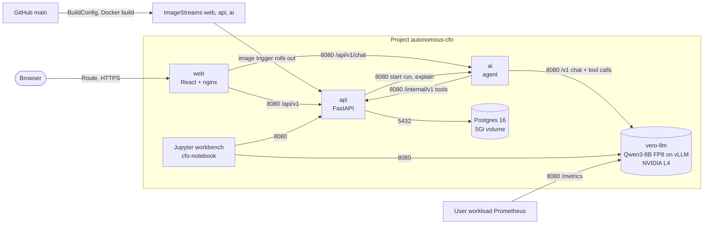
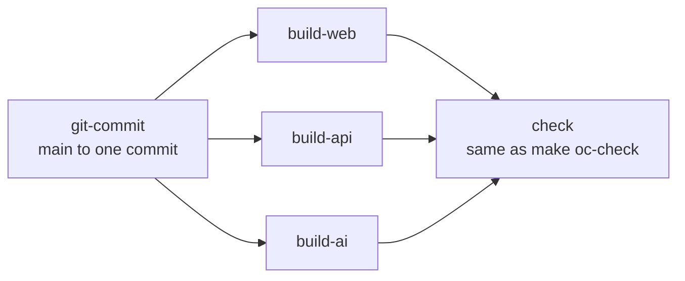

# Vero on OpenShift AI

How the app runs on our cluster, how it is secured, and how to set it up again from zero.
The design behind it is in [ARCHITECTURE.md](ARCHITECTURE.md). This file is about what is actually deployed.

Cluster: single node OpenShift 4.20.46 with OpenShift AI 3.5.3, 32 CPU, about 121 GiB RAM, one NVIDIA L4 (24 GB).
Everything runs in the project `autonomous-cfo`.

## 1. What runs where



Every arrow is a connection that a NetworkPolicy allows. Anything not drawn is blocked (section 3).

| Component | How it runs | Image | CPU request / limit | Memory request / limit | Health check |
|---|---|---|---|---|---|
| web | Deployment + Route (edge TLS) | built from `apps/web`, UBI 9 Node.js 22 build, UBI 9 nginx 1.24 | 50m / 500m | 64Mi / 256Mi | `/health` |
| vero-llm | KServe InferenceService, vLLM runtime | `registry.redhat.io/rhaii/vllm-cuda-rhel9` + model from the OpenShift AI catalog | 2 / 8 + 1 GPU | 8Gi / 16Gi | KServe |
| api | Deployment, 1 replica | built from `services/api` on UBI 9 Python 3.12 | 250m / 1 | 512Mi / 1Gi | `/api/v1/health/ready`, `/api/v1/health/live` |
| ai | Deployment, 1 replica | built from `services/ai` | 100m / 500m | 256Mi / 512Mi | `/health/live` |
| db | Deployment + PersistentVolumeClaim (gp3-csi, 5Gi) | `registry.redhat.io/rhel9/postgresql-16` | 250m / 1 | 512Mi / 1Gi | `pg_isready` |
| cfo-notebook | OpenShift AI workbench | Standard Data Science notebook 3.5 | 2 / 2 | 4Gi / 4Gi | OpenShift AI |

The GPU is only used by the model. The web, api, ai and db pods together ask for less than one CPU.

In the console's Topology view the pods are grouped as the application `vero`, with runtime icons and arrows for
who calls whom (`app.openshift.io/runtime` labels and `app.openshift.io/connects-to` annotations).
The Postgres volume is labeled for the OpenShift AI dashboard, so it shows up under Cluster storage next to the workbench.

## 2. The model

- Qwen3-8B, FP8 dynamic quantization, taken as a ready OCI "modelcar" image from the OpenShift AI catalog
  (`oci://registry.redhat.io/rhelai1/modelcar-qwen3-8b-fp8-dynamic:1.5`). No model files are copied by hand.
- Served by vLLM 0.24 (Red Hat AI Inference Server image) with an OpenAI-compatible API, model name `vero-llm`.
- vLLM settings: 32k context, `--enable-auto-tool-choice --tool-call-parser=hermes` for the agent's tool calls,
  `--reasoning-parser=qwen3` with thinking off by default, 90 % of GPU memory for the model and KV cache.
- The ai service reaches it at `http://vero-llm-predictor.autonomous-cfo.svc.cluster.local:8080/v1`. It has no Route,
  so it is not reachable from outside the cluster.
- Measured in [notebooks/model-benchmark.ipynb](../notebooks/model-benchmark.ipynb): first token after 0.07 s,
  27 tokens/s for one request, 204 tokens/s in total with 8 requests at once, 10 of 10 agent runs within 8 tool calls and 60 s.

Files: `deploy/openshift/model/` (ServingRuntime and InferenceService).

## 3. Network and security

Ingress inside the project is closed by default and opened only where a service needs it
(`deploy/openshift/network/`, applied with `make oc-network`):

| Policy | Pods it protects | Who may connect |
|---|---|---|
| `db-from-api` | db | api, port 5432 |
| `ai-from-api` | ai | api, port 8080 |
| `ai-from-web` | ai | web, port 8080 (nginx sends `/api/v1/chat` to the ai service) |
| `api-from-web-ai-workbench` | api | web, ai and the workbench, port 8080 |
| `model-from-ai-workbench` | vero-llm | ai and the workbench, port 8080, plus the monitoring namespaces for metrics |
| `web-from-router` | web | the OpenShift router, port 8080 |
| `mlflow-from-ai-workbench` | mlflow | ai and the workbench, port 8080 |
| `default-deny-ingress` | everything in the project | nobody, unless a policy above allows it |

Tested with a pod without labels, once from another project and once from this project: before the policies it could
reach db, api, ai and the model, after them all four time out. The workbench still reaches api and model, the agent run
still finishes in AGENT mode. `oc port-forward` and `oc exec` are not affected, so the team can still look into the database.

Other rules every pod follows:

- Runs as non-root with the random UID that OpenShift gives (restricted-v2 SCC), no privilege escalation,
  all capabilities dropped, seccomp `RuntimeDefault`.
- Base images come from Red Hat registries (UBI 9, RHEL 9), not from Docker Hub.
- Every container has CPU and memory requests and limits.
- web and api wait 5 s in `preStop` before they stop, so the router and the Service stop sending them requests first.
  The web rolls out with RollingUpdate and no failed requests (tested with constant requests during a restart).
  The api keeps runs and their timers in memory, so it runs as one replica with `Recreate`: two copies at once would split
  that state. The price is a gap of about 3 s during an api rollout (the browser polls get 502 and retry), so we do not
  deploy the api during a demo. ai and db also use `Recreate` (one replica, one volume for the db).
- Secrets (`db` with the Postgres password and `DATABASE_URL`, `internal-token` for the ai to api calls) are generated
  inside the cluster with `openssl rand` by the make targets. They are never written to a file or to git.
- Only the web has a Route. nginx only forwards `/api/v1/*`, so `/internal/*` stays inside the cluster
  (checked: `/internal/v1/tools` on the Route returns the web page, not the api).
- nginx compresses JS and CSS (the main bundle goes from 789 KB to 271 KB) and caches the hashed files under `/assets/`.

## 4. Build and deploy

The cluster builds the images itself. Each service has a BuildConfig (Docker strategy) that clones `main` from GitHub
and builds its folder (`apps/web`, `services/api`, `services/ai`). The result goes into an ImageStream, and an image trigger on the
Deployment rolls out the new image. No registry outside the cluster is needed.

From zero, logged in with `oc` to the cluster:

```bash
oc new-project autonomous-cfo
oc label namespace autonomous-cfo opendatahub.io/dashboard=true
oc apply -f deploy/openshift/model/
make oc-db-deploy
make oc-ai-build oc-ai-deploy
make oc-api-build oc-api-deploy
make oc-web-build oc-web-deploy
make oc-network
make oc-monitoring
make oc-pipeline
make oc-check
```

Notes:

- `make oc-api-deploy` creates the statement ConfigMap from `data/pizzeria-amalfi-bank-statement-2025-v6.csv`.
  That file comes from the organizers and is not in git, so put it into `data/` first.
- The api reads the bank statement from the `bank_statement_lines` table in Postgres (`STATEMENT_SOURCE=db`, 1125 lines for 2025).
- The label makes the project show up in the OpenShift AI dashboard. The workbench is created there
  (Standard Data Science image).
- A new build after a merge: `make oc-pipeline-run` (see below), or by hand `oc start-build api -n autonomous-cfo --follow`
  (or `ai`, `web`). The image trigger does the rollout.

### Pipeline (OpenShift Pipelines)

The pipeline `vero-ci` (Tekton, OpenShift Pipelines 1.24) builds, rolls out and checks the app in one run.
It shows up in the console under Pipelines, where it can also be started with the Start button.



| Task | What it does |
|---|---|
| `git-commit` | Finds the commit `main` points to, so every build of the run uses the same code |
| `build-web`, `build-api`, `build-ai` | Start the BuildConfig at that commit and stream its log, wait until the Deployment uses the new image digest, then wait for the rollout. They run in parallel |
| `check` | Checks the model is Ready, the deployments are rolled out and the network policies are there, then runs `deploy/openshift/check.py` from the same commit inside the api pod |

```bash
make oc-pipeline
make oc-pipeline-run
```

`make oc-pipeline` creates the Tasks and the Pipeline (once, or after changing them). `make oc-pipeline-run` starts a run,
waits for it and exits with 1 if a task fails. Parameters: `components` (default `web`, `api`), `branch` (default `main`) and `check` (default `true`).
The ai is not built by default: the ai code on `main` needs the new ai Deployment (more memory, MLflow settings),
so apply it first with `make oc-ai-deploy`, then start the pipeline with `components` set to `web`, `api`, `ai`.
The check resets the demo, so do not run the pipeline during a demo.

How it is set up: the runs use the `pipeline` service account, which has the `edit` role in this project only.
Every step has CPU and memory requests and limits, the images are UBI 9 Python and the cluster's own `openshift/cli`,
and no volume or secret is needed (the repository is public). The builds still happen in the BuildConfigs,
so a build started by hand and one started by the pipeline are the same.

## 5. Checking and operating it

`make oc-check` is the check we run before every demo. It shows the deployments, the InferenceService and the number of
network policies, then runs a script inside the api pod that checks api, database, ai and model health, plans the June
closure through the real agent and resets the demo. It exits with 1 if anything fails.

```
ok    api live
ok    api ready (database + statement loaded)  {"status": "ok", "state_loaded": true}
ok    ai service
ok    model reachable  vero-llm 55 ms
ok    demo reset  as_of_date=2025-05-05
ok    agent run finished  status=SUCCEEDED
ok    agent used the model  mode=AGENT
ok    agent within 60 s  23.2 s
ok    agent within 8 tool calls  4 calls
ok    agent made recommendations  2 recommendations
ok    demo reset  as_of_date=2025-05-05

ALL CHECKS PASSED
```

Monitoring: `make oc-monitoring` turns on user workload monitoring, so Prometheus scrapes the vLLM metrics of the model.
They show up in the OpenShift AI dashboard under the model deployment, and in the console under Observe > Metrics,
for example:

- `vllm:e2e_request_latency_seconds_count` (requests served)
- `vllm:generation_tokens_total` (tokens generated)
- `vllm:num_requests_running` (requests in flight)
- `vllm:kv_cache_usage_perc` (KV cache use on the GPU)

Everyday commands:

```bash
oc get pods -n autonomous-cfo
oc logs -f deploy/api -n autonomous-cfo
oc logs -f deploy/ai -n autonomous-cfo
oc exec -it deploy/db -n autonomous-cfo -- bash -c 'PGPASSWORD=$POSTGRESQL_PASSWORD psql -h 127.0.0.1 -U $POSTGRESQL_USER -d $POSTGRESQL_DATABASE'
oc port-forward svc/api 8000:8080 -n autonomous-cfo
```

## 6. Notebooks

The workbench `cfo-notebook` runs next to the app and talks to the same model and api.
See [NOTEBOOKS.md](NOTEBOOKS.md): a model benchmark, a cash flow analysis of the bank statement,
and a check of the forecast against the real year plus five agent runs on the same event.
